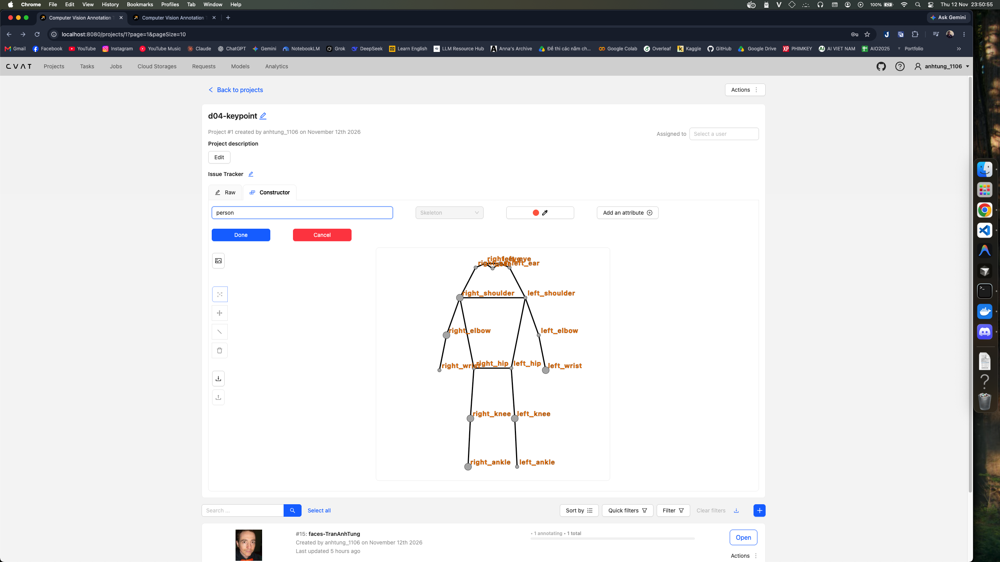
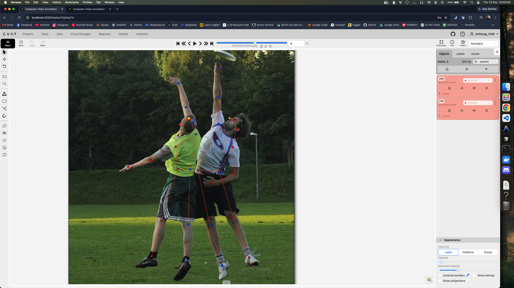
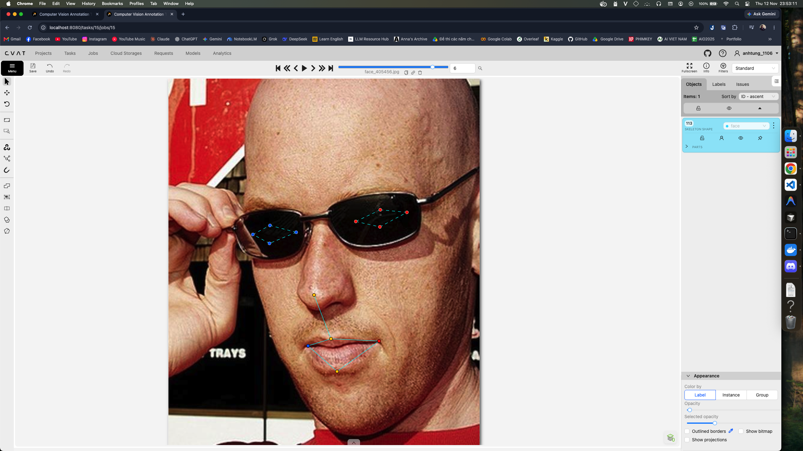
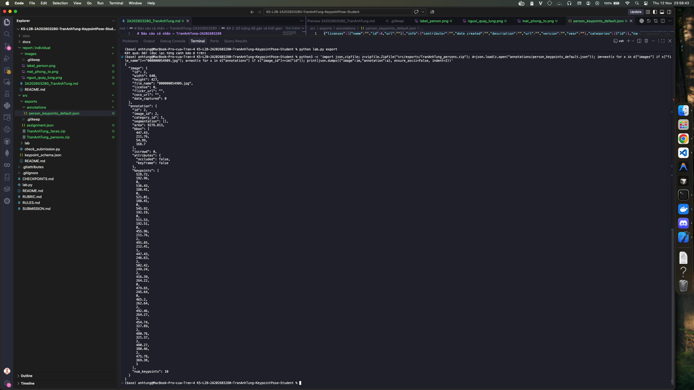

# Báo cáo cá nhân — TranAnhTung-2A202603280

Dữ liệu: 12 ảnh người COCO val2017 (Lin et al., 2014) và 8 ảnh chân dung Wikimedia Commons, chỉ dùng trong lớp.

## 0. Thông tin học viên

- Họ tên: Trần Anh Tùng
- MSSV: 2A202603280
- Email: trantung110604@gmail.com
- Link repository: https://github.com/trananhtung1/K5-L2B-2A202603280-TranAnhTung-KeypointPose-Student
- Phiên bản CVAT (Help → About): 2.74.1
- Máy: hệ điều hành macOS 15.7.5 · RAM 8 GB · chạy CVAT chế độ đầy đủ
- Bộ ảnh (`src/exports/assignment.json` do `lab.py setup` tạo): có
- Giờ bắt đầu: Không ghi chép chính xác
- Giờ kết thúc: Không ghi chép chính xác

## 1. Kiểm tra label (CP0)

| Label | Kiểu | Số điểm | Tên điểm đúng bảng của lab? | Đúng thứ tự? | Số cạnh |
|---|---|---:|---|---|---:|
| `person` | Skeleton | 17 | Có | Có | 19 |
| `face` | Skeleton | 13 | Có | Có | 13 |

Mẫu `person` dựng theo người quay mặt về camera (các điểm `left_*` nằm bên phải khung mẫu)? Có

Cách đổi cờ `occluded` / `outside` cho **một điểm** trên phiên bản CVAT này (một câu):

Rê chuột lên đúng keypoint, bấm `Q` để bật/tắt `occluded` (`v = 1`) hoặc bấm `O` để bật/tắt `outside` (`v = 0`); cũng có thể nhấp chuột phải lên điểm và chọn cờ tương ứng.

## 2. Số lượng đã gán và thời gian (CP1, CP2)

| Nhóm ảnh | Số ảnh | Số skeleton đã gán | Số người dưới 60 px (không gán) | Số poster / gương / màn hình bỏ qua | Thời gian (phút) |
|---|---:|---:|---:|---:|---:|
| `easy` | 5 | 5 | 0 | 0 | Ước lượng 5–10 |
| `occluded` | 3 | 8 | 0 | 0 | Ước lượng 15–30 |
| `back` | 2 | 4 | 0 | 0 | Ước lượng 10–20 |
| `small` | 1 | 2 | 0 | 0 | Ước lượng 5–10 |
| `crowd` | 1 | 3 | 0 | 0 | Ước lượng 5–10 |
| `faces` | 8 | 8 | 0 | 0 | Ước lượng 24–48 |

Danh sách nhóm ảnh người do `setup` giao:

- `easy`: `000000021235.jpg`, `000000137767.jpg`, `000000433787.jpg`, `000000463932.jpg`, `000000525227.jpg`.
- `occluded`: `000000078170.jpg`, `000000193879.jpg`, `000000461389.jpg`.
- `back`: `000000054909.jpg`, `000000210604.jpg`.
- `small`: `000000106051.jpg`.
- `crowd`: `000000272026.jpg`.
- `faces`: `face_122747.jpg`, `face_145621.jpg`, `face_249336.jpg`, `face_333134.jpg`, `face_362568.jpg`, `face_380639.jpg`, `face_405456.jpg`, `face_416730.jpg`.

- Số ảnh người đã xong ở mốc phút 105: Không ghi chép / 10
- Thời gian thực tế (phút): Không ghi chép chính xác; các số trong bảng là ước lượng.
- Ảnh tốn thời gian nhất là ảnh nào, vì sao?

`000000193879.jpg` tốn thời gian nhất vì cần căn chỉnh skeleton cho hai người phía sau, trong khi nhiều bộ phận bị che khuất và phải xác định cờ visibility cho từng điểm. Phần gán khuôn mặt nhìn chung nhanh, khoảng 3–6 phút mỗi ảnh; không có khó khăn lớn ngoài việc xác định cờ visibility ở ảnh kính râm.

## 3. Bảng ca khó (CP1, CP2)

Mỗi điểm bạn phân vân một dòng, nhất là phân vân giữa `v = 1` và `v = 0`, hoặc không chắc hướng người.

| Ảnh | Người / mặt | Điểm | Cờ đã chọn | Phân vân giữa | Lý do chọn |
|---|---|---|---:|---|---|
| `000000193879.jpg` | Hai người phía sau | Các khớp bị che | `v = 1` / `v = 0` theo từng điểm | `v = 1` / `v = 0` | Hai người cao trên 60 px và bị che nhiều. Điểm suy luận chắc từ các phần cơ thể còn thấy được đặt `v = 1`; điểm không đủ căn cứ đặt `v = 0`. |
| `face_405456.jpg` | Mặt kính râm | 8 điểm mắt | `v = 1` | `v = 1` / `v = 2` | Kính râm tối che mắt; ước lượng vị trí điểm theo hình dạng tròng và gọng kính nên dùng `occluded`. |

## 4. Bảng tự review (CP3)

Đi từ ảnh cuối về ảnh đầu. 5 ảnh người (ít nhất 2 ảnh `back` hoặc `crowd`) và 3 ảnh mặt. Ít nhất 8 dòng, kể cả dòng `ok`. Ghi lỗi trước, sửa sau.

Mã lỗi dùng đúng một trong: `lr_swap`, `vis_flag`, `position`, `missing`, `extra`, `ok`.

| Ảnh | Người / mặt | Điểm | Mã lỗi | Ghi chú | Đã sửa? |
|---|---|---|---|---|---|
| `000000461389.jpg` | Người #2 | `left_hip` | `vis_flag` | Điểm ở ngoài ảnh đang là `v = 1`; đã đổi sang `outside` (`v = 0`). | Có |
| `000000461389.jpg` | Người #2 | `right_hip` | `vis_flag` | Điểm ở ngoài ảnh đang là `v = 1`; đã đổi sang `outside` (`v = 0`). | Có |
| `000000210604.jpg` | Người #1 (back) | `eye`, `ear` | `lr_swap` | Script từng cảnh báo cặp mắt/tai ngược hướng; đã kiểm lại trái/phải và export sau đó không còn cảnh báo. | Có |
| `000000137767.jpg` | Người #1 | `left_wrist`, `right_wrist` | `lr_swap` | Script từng cảnh báo cặp cổ tay ngược hướng; đã kiểm lại và export sau đó không còn cảnh báo. | Có |
| `000000193879.jpg` | Người có cặp ankle bị cảnh báo | `left_ankle`, `right_ankle` | `ok` | Script cảnh báo hướng hai cổ chân ngược các cặp khác; đã kiểm lại bằng mắt theo tư thế thực tế và giữ nhãn. | Không cần sửa |
| `000000272026.jpg` | Các người đã gán (crowd) | Toàn skeleton | `ok` | Đã rà đủ skeleton, đường nối và cờ visibility trong ảnh đông người. | Không cần sửa |
| `000000054909.jpg` | Các người đã gán (back) | Toàn skeleton | `ok` | Đã rà trái/phải theo hướng người quay lưng và cờ visibility. | Không cần sửa |
| `face_405456.jpg` | Mặt kính râm | 8 điểm mắt | `ok` | Đã kiểm cờ `occluded`; 8 điểm mắt xuất ra `v = 1`. | Không cần sửa |
| `face_249336.jpg` | Mặt | 13 điểm mặt | `ok` | Đã rà thứ tự mắt trái/phải, chóp mũi và các điểm miệng. | Không cần sửa |
| `face_122747.jpg` | Mặt | 13 điểm mặt | `ok` | Đã rà vị trí mí mắt, khóe miệng và cờ visibility. | Không cần sửa |

Tổng hợp số lỗi theo mã:

| `lr_swap` | `vis_flag` | `position` | `missing` | `extra` | `ok` |
|---:|---:|---:|---:|---:|---:|
| 2 | 2 | 0 | 0 | 0 | 6 |

Điểm còn phân vân giữa `v = 1` và `v = 0` (ghi cả hai lựa chọn và lý do chọn):

Các điểm phân vân đã ghi trong bảng ca khó ở mục 3. Với điểm `v = 1`, chỉ giữ khi vị trí được suy luận chắc từ phần cơ thể hoặc cấu trúc còn thấy; nếu không đủ căn cứ thì dùng `v = 0`.

## 5. Kiểm file xuất và kết quả tự kiểm (CP4)

Tự kiểm tay trong file JSON:

| File | Người / mặt kiểm (ảnh, thứ tự) | Số phần tử `keypoints` | Điểm `outside` ra `v = 0`, `occluded` ra `v = 1`? | `num_keypoints` khớp? |
|---|---|---:|---|---|
| `TranAnhTung_persons.zip` | `000000054909.jpg`, #1 | 51 | Có: điểm `outside` xuất `v = 0`; điểm `occluded` xuất `v = 1` | Có, `num_keypoints = 10` |
| `TranAnhTung_persons.zip` | `000000054909.jpg`, #2 | 51 | Có: có cả `v = 0`, `v = 1` và `v = 2` | Có, `num_keypoints = 11` |
| `TranAnhTung_faces.zip` | `face_405456.jpg`, #1 | 39 | Có: 8 điểm mắt kính râm xuất `v = 1`; ảnh này không có điểm `outside` | Có, `num_keypoints = 13` |

Sau khi xuất, CVAT ghi `occluded` thành `v = 1` và `outside` thành `v = 0`. Tọa độ của điểm `outside` trong file vẫn có thể là tọa độ cũ (CVAT 2.x), không nhất thiết là `0, 0`.

Hai job đã chuyển sang completed trên CVAT? Có

Dán phần **TÓM TẮT** in ra từ `src/check_submission.py`:

```text
File person: TranAnhTung_persons.zip
  Số ảnh: 12 · số skeleton `person`: 22 · mỗi annotation 51 số
  Skeleton theo ảnh: 000000021235=1, 000000054909=2, 000000078170=2, 000000106051=2, 000000137767=1, 000000193879=3, 000000210604=2, 000000272026=3, 000000433787=1, 000000461389=3, 000000463932=1, 000000525227=1
  Cờ v: v=2 257 (69%) · v=1 31 (8%) · v=0 86 (23%)
  num_keypoints trung bình: 13.1
File face: TranAnhTung_faces.zip
  Số ảnh: 8 · số skeleton `face`: 8 · mỗi annotation 39 số
  Skeleton theo ảnh: face_122747=1, face_145621=1, face_249336=1, face_333134=1, face_362568=1, face_380639=1, face_405456=1, face_416730=1
  Cờ v: v=2 96 (92%) · v=1 8 (8%) · v=0 0 (0%)
  num_keypoints trung bình: 13.0
  Ghi chú: 86 điểm v = 0 vẫn mang tọa độ cũ (CVAT 2.x xuất như vậy; chuẩn COCO ghi 0, 0). Không phải lỗi: điểm v = 0 bị bỏ qua khi huấn luyện và khi chấm.
  Số [LỖI]: 0 · số [CẢNH BÁO]: 1
Kết quả: ĐẠT (đọc lại từng cảnh báo ở trên)
```

Các `[CẢNH BÁO]` còn giữ nguyên và lý do:

`000000193879.jpg`: Script cảnh báo một cặp ankle có hướng ngược với các cặp khớp khác. Đã kiểm lại bằng mắt theo tư thế thực tế trong ảnh; giữ nguyên nhãn sau self-review.

## 6. Ảnh chụp màn hình

1. Label `person` trong label constructor (đủ 17 điểm có tên):

   

2. Một người quay lưng đã gán, cờ đã đặt:

   

3. Một khuôn mặt đã gán 13 điểm, phóng to vùng mắt:

   

4. Một đoạn JSON xuất của một người:

   

Nguồn ảnh: COCO val2017 / Wikimedia Commons.

**[Bạn phải tự lưu đủ bốn ảnh vào thư mục `report/individual/images/` với đúng tên ở trên.]**

## 7. Tự đánh giá

1. Lỗi bạn mắc nhiều nhất hôm nay, và cách bạn sẽ tránh ở dự án thật:

   Điểm khó nhất là quyết định giữa `v = 1` và `v = 0` ở các vùng bị che. Ở dự án thật, tôi sẽ chỉ dùng `v = 1` khi có cơ sở hình học rõ từ các khớp hoặc chi còn thấy; nếu nhiều khả năng vị trí khác nhau, tôi sẽ chọn `v = 0` và ghi lý do.

2. Một quy tắc bạn đề xuất thêm vào guideline (kèm ảnh ví dụ nếu có):

   Thêm một checklist ngắn cho ảnh đông người: lần từng chi từ vai/hông của đúng người trước khi đặt khuỷu, cổ tay, gối và cổ chân; sau đó kiểm đường nối có đi sang người khác hay không.

3. Nhãn của bạn đi vào model ở đâu? Chọn một lỗi bạn đã sửa và nói nó sẽ làm model học sai thế nào (heatmap, trọng số trong loss, hay bước lật ảnh):

   Tôi đã rà lại nguy cơ `lr_swap` ở cặp cổ chân trong `000000193879.jpg`. Nếu một cặp trái/phải bị đổi, heatmap của hai cổ chân sẽ được dạy ở phía sai; khi lật ảnh để tăng dữ liệu, ánh xạ trái/phải tiếp tục sai và làm giảm chất lượng pose model.

## 8. Khó khăn và lỗi kỹ thuật

Tôi quên mật khẩu CVAT local. Sau khi xác định đúng username, tôi đặt lại mật khẩu bằng lệnh quản trị trong container `cvat_server`, đăng nhập lại và tiếp tục xuất bài. Tôi cũng kiểm tra lại kết quả bằng `python lab.py export` sau khi sửa cờ keypoint.

## Bonus (nếu làm)

### B1 — 3 ảnh người khó thêm

| Ảnh | Số skeleton | Số người dưới 60 px | Ca khó nhất |
|---|---:|---:|---|
| | | | |
| | | | |
| | | | |

Kết quả `src/check_submission.py` cho `HoVaTen_bonus_persons.zip`:

```text
(dán ở đây)
```

### B2 — 5 ảnh khuôn mặt đen trắng / hồng ngoại

Ảnh không màu khó hơn ở điểm nào? Kính râm trên ảnh hồng ngoại có còn là `v = 1` không?

...

### B3 — Model so với nhãn của tôi (không tính điểm)

- Demo đã dùng:
- Ảnh đã thử:

1. Model có trả điểm cho khớp bị che, hay khớp ngoài ảnh không? Confidence ở các điểm đó thế nào?

   ...

2. Với người quay lưng, model có đổi trái/phải không?

   ...

3. Bộ điểm của model có giống 17 điểm COCO không?

   ...

## 9. Tài liệu tham khảo và công cụ AI đã dùng

- Tài liệu nội bộ của lab: `README.md`, `docs/GUIDELINE.md`, `docs/CVAT_CHEATSHEET.md`, `CHECKPOINTS.md`, `SUBMISSION.md`.
- Trợ lý AI Codex/ChatGPT: hỏi cách thao tác CVAT, ý nghĩa cờ visibility, đọc kết quả script export và hỗ trợ diễn đạt báo cáo. Tôi tự thực hiện việc gán nhãn và tự xác nhận các vị trí keypoint trên CVAT.
